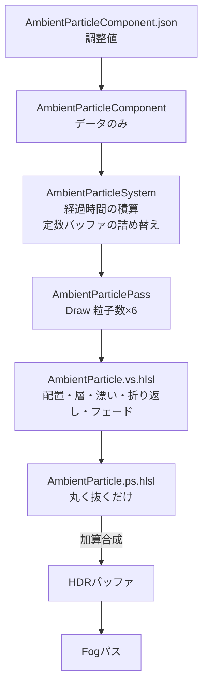

3Dアクションのフィールドを作っていると、キャラクターと地面の間の空間が**空っぽ**のままになりがちです。

何も浮かんでいない空間は奥行きが分かりにくく、**空気がそこにある感じ**が出ません。

そこで空中に火の粉や塵を漂わせると、手前と奥で粒の大きさや流れる速さが違って見え、それだけで空間に厚みが生まれます。

しかし、空間全体を埋めるには**何千粒**という数が必要になります。

1粒ごとに位置や速度をバッファへ持たせると、CPUで毎フレーム更新する必要があり、カメラが遠くへ移動したときに粒子をどう補充するかも考えなければなりません。

本記事では、自作エンジン``TsukinoEngine``（``DirectX11`` / ``HLSL``）で制作中のゲーム``CombatAndroid``のコードを用いて、**粒子1粒あたりのメモリを持たずに、カメラがどこへ動いても途切れない粒子を描く**方法を解説したいと思います。

https://github.com/tsukinokun/TsukinoEngine

https://github.com/tsukinokun/combat-android

## 想定環境

- ``Windows11``
- ``DirectX11``
- ``VisualStudio2026``

## 前提知識

- ``C++``の基礎文法を理解している
- ``HLSL``を理解している
- ``ビルボード``を理解している
- ``DeferredRendering``を理解している

``DeferredRendering``については[理論編](https://qiita.com/tsukino_/items/571131bb3afe95fa39c1)と[実装編](https://qiita.com/tsukino_/items/181a870bb3bab7075538)で扱っています。

https://qiita.com/tsukino_/items/571131bb3afe95fa39c1

https://qiita.com/tsukino_/items/181a870bb3bab7075538

# 環境パーティクルの考え方

本記事のパーティクルは、**頂点バッファもインデックスバッファも持たず、`Draw`を1回呼ぶだけ**で描いています。

1粒は三角形2枚（``6頂点``）のビルボードなので、``粒子数 × 6``頂点を描画するように指定するだけです。

1粒ごとの位置・大きさ・明るさ・速さは、すべて**粒子番号のハッシュ**から、頂点シェーダーが毎フレーム計算し直します。

```Plain Text
1. CPU：パラメータを定数バッファへ詰め、Draw(粒子数 × 6) を呼ぶ
   ↓
2. GPU：SV_VertexID → 粒子番号と角の番号 → ハッシュ → 位置・大きさ・明るさ
   ↓
3. GPU：経過時間で漂わせ、カメラを中心としたボリュームで折り返す
   ↓
4. GPU：中心からの距離で丸く抜き、HDRバッファへ加算合成
```

そのため、``count``（粒子数）を増やしてもメモリは1バイトも増えません。

増えるのは頂点シェーダーの実行回数と塗りつぶし量だけです。



### 環境パーティクルの見た目例


# SV_VertexIDから粒子を作る

## 頂点番号を粒子と角へ分解する

``TsukinoEngine``では`AmbientParticle.vs.hlsl`がこの処理を担当します。

```hlsl:AmbientParticle.vs.hlsl
static const float2 kCorners[6] = {
    float2(-1.0f, -1.0f), float2( 1.0f, -1.0f), float2(-1.0f,  1.0f),
    float2(-1.0f,  1.0f), float2( 1.0f, -1.0f), float2( 1.0f,  1.0f)
};

VSOutput VSMain(uint id : SV_VertexID)
{
    VSOutput output;

    //----------------------------------------------------------
    // 頂点IDを「何粒目の・どの角か」へ分解する
    //----------------------------------------------------------
    const uint particleIndex = id / 6u;
    const uint cornerIndex   = id % 6u;

    // 1粒につき乱数を5本引くので、番号を8刻みにして種の衝突を避ける
    const uint seed = (uint)fadeParams.z + particleIndex * 8u;

    // （以下省略）
}
```

### Corner / 板の角

```hlsl:AmbientParticle.vs.hlsl
const uint particleIndex = id / 6u;
const uint cornerIndex   = id % 6u;
```

`SV_VertexID`を**何粒目の、どの角か**に分解します。

角の位置は`kCorners`に``-1〜1``の座標で持っておき、後でカメラの右・上ベクトルに掛けて板にします。

頂点バッファが無いので、``入力レイアウト``も不要です。

### Seed / 種を8刻みにする

```hlsl:AmbientParticle.vs.hlsl
const uint seed = (uint)fadeParams.z + particleIndex * 8u;
```

1粒につき、位置のXYZ・層・位相の**5本**の乱数を`seed + 0u`〜`seed + 4u`で引きます。

粒子番号をそのまま種にすると、``0番``の`seed + 1u`と``1番``の`seed + 0u`が**同じ値**になってしまいます。

番号を``8刻み``にすることで、隣の粒子と種がぶつからないようにしています。

## ハッシュで乱数を作る

```hlsl:AmbientParticle.vs.hlsl
uint HashU32(uint x)
{
    x ^= x >> 16;
    x *= 0x7feb352du;
    x ^= x >> 15;
    x *= 0x846ca68bu;
    x ^= x >> 16;
    return x;
}

float Rand01(uint x)
{
    return float(HashU32(x) & 0x00ffffffu) * (1.0f / 16777216.0f);
}
```

乗算と右シフトXORを交互に掛けるだけなので、非常に安価です。

**連番を入れても隣どうしの相関が残らない**ことが重要で、これが無いと粒子が規則的な模様に並んでしまいます。

### Rand01 / 下位24ビット

```hlsl:AmbientParticle.vs.hlsl
return float(HashU32(x) & 0x00ffffffu) * (1.0f / 16777216.0f);
```

``float``の仮数部は24ビットなので、下位24ビットだけを使って``2^24``で割ると、分布に偏りが出ません。

同じ理由で、CPU側から渡すシードも24ビットに丸めています。

```cpp:AmbientParticleSystem.cpp
float seed = static_cast<float>(activeParticle->seed & 0x00ffffffu);
```

シードは定数バッファの``float4``に載せて渡すので、``2^24``を超える整数は``float``で正確に表せず、別の値に化けてしまいます。

## ボリューム内のどこに居るか

```hlsl:AmbientParticle.vs.hlsl
float3 unitPos = float3(Rand01(seed + 0u), Rand01(seed + 1u), Rand01(seed + 2u));
```

まず``0〜1``の立方体の中の位置を決め、後でボリュームの大きさへ引き伸ばします。

# 層を1本の乱数で決める

## 大きさ・明るさ・速さを連動させる

ここが見た目に一番効いている部分です。

```hlsl:AmbientParticle.vs.hlsl
//----------------------------------------------------------
// 層（0 = 大きく暗くゆっくり ⇔ 1 = 小さく明るく速い）
//
// 乱数を1本だけ引いて3つのパラメータを同じ向きに補間するのが要点。
// 別々の乱数にすると「大きくて速くて明るい粒」が混ざって画が汚れる。
// 1本にまとめることで、1回の描画でも遠近の層があるように見える
//----------------------------------------------------------
float layer      = Rand01(seed + 3u);
float radius     = lerp(sizeParams.y, sizeParams.x, layer);
float brightness = lerp(sizeParams.z, sizeParams.w, layer);
float speedScale = lerp(swayParams.y, swayParams.z, layer);
```

大きさ・明るさ・速さを、**1本の乱数`layer`で同じ向きに**補間しています。

| layer | 大きさ | 明るさ | 速さ | 見え方 |
|---|---|---|---|---|
| 0 | 大きい | 暗い | 遅い | ぼんやり漂う灰 |
| 1 | 小さい | 明るい | 速い | 勢いよく流れる火の粉 |

**3つを別々の乱数で決めてはいけません。**

別々にすると**大きくて明るくて速い粒**が混ざり、それが画面の中で一番目立つため、全体がうるさく見えます。

1本にまとめると、**大きくてゆっくりな粒は奥に、小さくて速い粒は手前に**あるように錯覚し、1回の描画でも遠近の層があるように見えます。


### Phase / 位相をずらす

```hlsl:AmbientParticle.vs.hlsl
float phase = Rand01(seed + 4u) * TWO_PI;
```

残りの1本は、揺らぎときらめきの位相に使います。

粒子ごとに位相をずらすことで、**全体が一斉に揺れる**のを防ぎます。

# 漂わせる

## ドリフトと揺らぎ

```hlsl:AmbientParticle.vs.hlsl
const float time  = volumeParams.w;
const float omega = driftParams.w;

//----------------------------------------------------------
// 一定のドリフトに、軸ごとに周期をずらしたサインの揺らぎを重ねる。
// 周期を互いに割り切れない倍率でずらすと、軌道が閉じずに漂って見える
//----------------------------------------------------------
float3 drift = driftParams.xyz * (speedScale * time);
float3 sway  = float3(sin(time * omega         + phase),
                      sin(time * omega * 0.73f + phase * 1.7f),
                      cos(time * omega * 0.61f + phase * 2.3f)) * swayParams.x;

float3 rawPos = unitPos * volumeParams.xyz + drift + sway;
```

動きは次の2つの成分の和です。

| 成分 | 内容 |
|---|---|
| ドリフト | 全粒子に共通の一定の流れ。層に応じた速度倍率が掛かる |
| 揺らぎ | 軸ごとに周期の違うサイン波で、その場でふわふわ漂う |

### Drift / 位置は時間から直接求める

```hlsl:AmbientParticle.vs.hlsl
float3 drift = driftParams.xyz * (speedScale * time);
```

前フレームの位置に速度を足していく方式ではなく、**経過時間から位置を直接計算**しています。

前フレームの位置を覚えておく必要が無いので、ここでも粒子ごとのメモリを持たずに済みます。

`driftVelocity`を上向きにすると粒が舞い上がり、下向きにすると降ってきます。

### Sway / 周期を割り切れない倍率でずらす

```hlsl:AmbientParticle.vs.hlsl
float3 sway  = float3(sin(time * omega         + phase),
                      sin(time * omega * 0.73f + phase * 1.7f),
                      cos(time * omega * 0.61f + phase * 2.3f)) * swayParams.x;
```

X・Y・Zで周期を``1.0倍``・``0.73倍``・``0.61倍``とずらしています。

3軸を同じ周期にすると、粒子は**同じ円（楕円）をぐるぐる回るだけ**になります。

互いに割り切れない倍率にすると、軌道がなかなか閉じず、**あてもなく漂っている**ように見えます。

## 時間はシステム側で積算する

```cpp:AmbientParticleSystem.cpp
m_time += deltaTime;
```

経過時間は`AmbientParticleSystem`で`deltaTime`を積算し、`volumeParams.w`として渡しています。

ゲームの`deltaTime`は時間スケールの影響を受けるので、**ヒットストップ中は粒子も空中で止まります。**

攻撃が当たった瞬間に世界全体が止まり、粒子だけが動いていると、不揃いに見えてしまいます。

# カメラを中心に折り返す

## 有限の粒子で無限の空間を埋める

ここが本記事で一番重要な部分です。

粒子は``24m × 9m × 24m``のボリュームの中にしか居ません。

カメラがボリュームの外へ出ると、当然そこには粒子がありません。

そこで、**ボリュームをカメラに追従させ、はみ出した粒子を反対側へ折り返します。**

```hlsl:AmbientParticle.vs.hlsl
//----------------------------------------------------------
// カメラを中心にボリュームで折り返す（この技法の要）
//
// frac()は負数でも0〜1を返すので、これだけで座標がボリュームの
// 剰余に畳み込まれる。カメラが動けば折り返しの基準も一緒に動くため、
// 有限の粒子数で「どこまでも続く粒子場」になる
//----------------------------------------------------------
float3 halfSize = volumeParams.xyz * 0.5f;
float3 origin   = cameraPos.xyz - halfSize;
float3 worldPos = origin + frac((rawPos - origin) / volumeParams.xyz) * volumeParams.xyz;
```

```Plain Text
     カメラが右へ移動
        ──→
┌─────────────────┐        ┌─────────────────┐
│ ・    ・     ・ │        │    ・     ・ ● ←┼─ 左端からはみ出た粒子が
│   ・   📷  ・   │   →   │  ・   📷  ・    │    右端へ回り込む
│ ●   ・    ・    │        │  ・    ・     ・│
└─────────────────┘        └─────────────────┘
```


### Origin / 折り返しの基準

```hlsl:AmbientParticle.vs.hlsl
float3 origin   = cameraPos.xyz - halfSize;
```

ボリュームの**角**をカメラ位置から求めています。

カメラが動けば基準も一緒に動くので、ボリュームは常にカメラを中心に置かれます。

### frac / 剰余に畳み込む

```hlsl:AmbientParticle.vs.hlsl
float3 worldPos = origin + frac((rawPos - origin) / volumeParams.xyz) * volumeParams.xyz;
```

基準からの相対位置をボリュームの大きさで割り、`frac`で小数部分だけを取り出します。

`frac(x)`は`x - floor(x)`なので、**負の値でも必ず``0〜1``を返します。**

そのため、ボリュームの左側へはみ出した粒子も右側へはみ出した粒子も、同じ1行でボリュームの中へ戻ってきます。

`fmod`を使うと、負の値で**負の余り**が返るので、左側へはみ出した粒子だけが戻ってこなくなります。

### ドリフトとの相性

`rawPos`は時間とともにどこまでも増えていきますが、折り返しがあるので、粒子がボリュームから流れ出てしまうことはありません。

**上へ流れ出た粒子は下から、風下へ流れ出た粒子は風上から**、途切れることなく補充されます。

## 境界フェード

折り返しには1つ問題があります。

折り返しの瞬間、粒子の座標は**ボリュームの反対側へ一瞬で飛びます。**

そのまま描くと、粒子が突然消えたり、何もない場所に突然現れたりする``ポップ``として見えてしまいます。

```hlsl:AmbientParticle.vs.hlsl
//----------------------------------------------------------
// 境界フェード
//
// 折り返しでは座標が不連続に飛ぶので、飛ぶ瞬間に粒子が消えていないと
// ポップとして見えてしまう。ボリュームの面までに必ず0になるよう、
// 各軸の比率の最大値（＝立方体の面への近さ）で減衰させる
//----------------------------------------------------------
float3 edgeRatio = abs(worldPos - cameraPos.xyz) / max(halfSize, 1.0e-4f);
float  edgeMax   = max(edgeRatio.x, max(edgeRatio.y, edgeRatio.z));
float  edgeFade  = 1.0f - smoothstep(fadeParams.x, 1.0f, edgeMax);
```

### EdgeRatio / 面への近さ

```hlsl:AmbientParticle.vs.hlsl
float3 edgeRatio = abs(worldPos - cameraPos.xyz) / max(halfSize, 1.0e-4f);
float  edgeMax   = max(edgeRatio.x, max(edgeRatio.y, edgeRatio.z));
```

カメラからの距離を軸ごとにボリュームの半分の長さで割ると、各軸で**中心が0、面が1**の比率になります。

その**最大値**を取ると、立方体の6面のうち**一番近い面への近さ**になります。

カメラからの距離（`length`）で減衰させると球になってしまい、**立方体の角の付近では、面に達しても消えきらない**粒子が出ます。

### edgeFadeStart / 1.0未満にする

```cpp:AmbientParticleSystem.cpp
float edgeFadeStart = std::clamp(activeParticle->edgeFadeStart, 0.0f, 0.99f);
```

``CombatAndroid``では`edgeFadeStart`を``0.65``にしていて、ボリュームの半径の``65%``から外側で消えていきます。

**この値を``1.0``にしてはいけません。**

`smoothstep(1.0, 1.0, x)`となりフェードの幅が無くなるので、折り返しがそのまま見えてしまいます。

そのため、システム側で``0.99``に抑えています。

## 近接フェード

```hlsl:AmbientParticle.vs.hlsl
float viewDist = length(worldPos - cameraPos.xyz);
float nearFade = smoothstep(0.0f, max(fadeParams.y, 1.0e-4f), viewDist);
```

カメラのすぐ目の前を粒子が通ると、1粒のビルボードが**画面の大部分を覆って**しまいます。

そこで、カメラから``60cm``以内の粒子は消しておきます。

# きらめき

```hlsl:AmbientParticle.vs.hlsl
//----------------------------------------------------------
// きらめき（揺らぎとは違う周期で明滅させてちらつきを作る）
//----------------------------------------------------------
float twinkle = lerp(1.0f - swayParams.w, 1.0f,
                     0.5f + 0.5f * sin(time * omega * 1.9f + phase * 3.1f));
```

火の粉は、空中で**ちらちらと明滅**して見えます。

揺らぎと同じ周期で明滅させると、**上がったときに明るく、下がったときに暗く**なるといった規則性が見えてしまいます。

そこで角速度を``1.9倍``、位相を``3.1倍``とずらし、動きと明るさの関係を崩しています。

| twinkle | 明るさの範囲 |
|---|---|
| 0.0 | 常に100%（明滅なし） |
| 0.6 | 40%〜100% |
| 1.0 | 0%〜100% |

# ビルボード

## ビュー行列からカメラの向きを取り出す

```hlsl:AmbientParticle.vs.hlsl
//----------------------------------------------------------
// ビルボード
//
// このエンジンは行ベクトル規約（mul(v, view)）なので、ビュー行列の
// 「列」がそのままカメラの右・上ベクトルになる。
// _m00/_m10/_m20 が0列目＝右、_m01/_m11/_m21 が1列目＝上
//----------------------------------------------------------
float3 camRight = float3(view._m00, view._m10, view._m20);
float3 camUp    = float3(view._m01, view._m11, view._m21);

float2 corner = kCorners[cornerIndex];
float3 offset = (camRight * corner.x + camUp * corner.y) * radius;

output.position = mul(float4(worldPos + offset, 1.0f), viewProj);
output.local    = corner;
```

粒子の中心から、カメラの右・上ベクトルの方向へ角を広げることで、常にカメラを向く板にします。

### Column / 行ではなく列を読む

```hlsl:AmbientParticle.vs.hlsl
float3 camRight = float3(view._m00, view._m10, view._m20);
```

**ここで行を読んではいけません。**

ビュー行列は、カメラの姿勢（ワールド行列）の**逆行列**です。

回転部分の逆行列は転置なので、``TsukinoEngine``のような行ベクトル規約（`mul(v, view)`）では、カメラの右・上ベクトルはビュー行列の**列**に入っています。

行（`_m00, _m01, _m02`）を読むと、カメラを回したときに**板がカメラの方を向かなくなります。**

### Local / 板の中の座標

```hlsl:AmbientParticle.vs.hlsl
output.local    = corner;
```

角の``-1〜1``の座標をそのまま渡しておき、ピクセルシェーダーで丸く抜くのに使います。

# ピクセルシェーダー

## テクスチャを使わずに丸く抜く

```hlsl:AmbientParticle.ps.hlsl
float4 PSMain(PSInput input) : SV_TARGET
{
    //----------------------------------------------------------
    // 中心からの距離で丸く抜く。四隅（距離約1.41）は完全に0になるので
    // 板の輪郭が四角く見えることはない
    //----------------------------------------------------------
    float r = length(input.local);

    // 外周へ向かってなめらかに0へ。二乗して中心に芯を残す
    float falloff = 1.0f - smoothstep(0.0f, 1.0f, r);
    falloff *= falloff;

    return float4(input.color.rgb, input.color.a * falloff);
}
```

ピクセルシェーダーは、**板の中心からの距離**で減衰させるだけです。

テクスチャも定数バッファも使いません。

色・明るさ・フェードはすべて頂点シェーダーが計算し、補間値として受け取っています。

### Falloff / 二乗して芯を残す

```hlsl:AmbientParticle.ps.hlsl
float falloff = 1.0f - smoothstep(0.0f, 1.0f, r);
falloff *= falloff;
```

| r（中心→外周） | `1 - smoothstep` | 二乗 |
|---|---|---|
| 0.00 | 1.000 | 1.000 |
| 0.25 | 0.844 | 0.712 |
| 0.50 | 0.500 | 0.250 |
| 0.75 | 0.156 | 0.024 |
| 1.00 | 0.000 | 0.000 |

二乗すると外側が急に暗くなり、**中心に明るい芯があって周りがぼんやりにじむ**見た目になります。

板の四隅は中心から``約1.41``離れているので、完全に``0``になります。

そのため、板の輪郭が四角く見えることはありません。

# 描画パス

## 頂点バッファなしで描く

``TsukinoEngine``では`AmbientParticlePass`がこの処理を担当します。

```cpp:AmbientParticlePass.cpp
//----------------------------------------------------------
// シェーダーをセット（頂点バッファが無いので入力レイアウトも不要）
//----------------------------------------------------------
context->VSSetShader(m_vs.Get(), nullptr, 0);
context->PSSetShader(m_ps.Get(), nullptr, 0);
context->IASetInputLayout(nullptr);

//----------------------------------------------------------
// 深度テストあり・深度書き込みなし・加算合成
//
// DepthReadReverseZはGREATER_EQUALなのでこのエンジンのリバースZと
// 一致する（DepthReadはLESS_EQUALなので使ってはいけない）。
// 深度を書かないことで粒子どうしの前後関係を気にせずに済み、
// 加算合成なので描画順のソートも不要になる
//----------------------------------------------------------
context->OMSetDepthStencilState(m_resources->GetCommonStatesTK()->DepthReadReverseZ(), 0);
context->OMSetBlendState(m_resources->GetCommonStatesTK()->Additive(), nullptr, 0xFFFFFFFF);
context->RSSetState(m_resources->GetCommonStatesTK()->CullNone());

//----------------------------------------------------------
// 頂点バッファなしで「1粒 = 三角形2枚」を一括描画
//----------------------------------------------------------
context->IASetVertexBuffers(0, 0, nullptr, nullptr, nullptr);
context->IASetIndexBuffer(nullptr, DXGI_FORMAT_UNKNOWN, 0);
context->IASetPrimitiveTopology(D3D11_PRIMITIVE_TOPOLOGY_TRIANGLELIST);
context->Draw(m_count * 6, 0);
```

### Draw / 頂点数だけを指定する

```cpp:AmbientParticlePass.cpp
context->Draw(m_count * 6, 0);
```

頂点バッファとインデックスバッファを外した状態で`Draw`を呼ぶと、頂点シェーダーには`SV_VertexID`だけが届きます。

GPUに送るデータは、``96バイト``の定数バッファ（``b9``）だけです。

### DepthReadReverseZ / 深度テスト

```cpp:AmbientParticlePass.cpp
context->OMSetDepthStencilState(m_resources->GetCommonStatesTK()->DepthReadReverseZ(), 0);
```

深度テストはありなので、粒子はキャラクターや地面にきちんと隠れます。

``TsukinoEngine``は``リバースZ``（手前が1、奥が0）なので、比較は``GREATER_EQUAL``です。

**一般的な`DepthRead`（``LESS_EQUAL``）を使ってはいけません。**

比較が逆になり、**物体の手前にある粒子が消えて、奥にある粒子だけが描かれます。**

### Additive / 深度を書かず加算合成する

```cpp:AmbientParticlePass.cpp
context->OMSetBlendState(m_resources->GetCommonStatesTK()->Additive(), nullptr, 0xFFFFFFFF);
```

深度は**書きません。**

書いてしまうと、手前の粒子の丸く抜いた**透明な四隅**が、奥の粒子を隠してしまいます。

加算合成は足す順番を入れ替えても結果が変わらないので、**半透明なのに奥から手前へのソートが要りません。**

ブレンドは``SRC_ALPHA / ONE``なので、頂点シェーダーでは色にアルファを事前乗算していません。

```hlsl:AmbientParticle.vs.hlsl
// ブレンドは SRC_ALPHA / ONE の加算なので、色には事前乗算しない
output.color = float4(colorParams.rgb * (colorParams.w * brightness * twinkle),
                      edgeFade * nearFade);
```

描き込み先は``HDR``バッファなので、`maxBrightness`を``1``より大きくすると、トーンマップで自然に丸まりながら明るくにじみます。

## フォグの前に描く

```cpp:Renderer.cpp
//------------------------------------------------------------
// 環境パーティクルパス（HDRバッファへ加算合成）
//
// 深度テストありなので世界の物体にきちんと隠れ、深度は書かないので
// 粒子どうしは順序を気にせず重なる。フォグの前に置くことで、
// 「3Dの絵すべてにフォグが乗る」という下のパスの前提を壊さずに済む
// （粒子だけがフォグの掛かっていない浮いた点に見えるのを防ぐ）。
//------------------------------------------------------------
m_ambientParticlePass.Execute();
```

パーティクルは、不透明・空・半透明・水面をすべて描き終わった後、**フォグパスの直前**に描いています。

フォグの後に描くと、遠くの地面や敵は霧に沈んでいるのに、**粒子だけがくっきり浮いて**見えてしまいます。

フォグの前に描けば、遠くの粒子も霧に溶け込みます。


# 1つの仕組みで火の粉にも雪にもなる

## エンジンは絵の判断をしない

``TsukinoEngine``の`AmbientParticleComponent`は、**火の粉専用ではありません。**

エンジンが持っているのは**GPUで大量の板を漂わせる仕組み**だけで、何に見せるかはゲーム側がパラメータで決めます。

色・大きさ・流れる向きを変えるだけで、次のような表現に使えます。

| 表現 | color | driftVelocity | その他 |
|---|---|---|---|
| 火の粉 | 暖色 | 上向き | `twinkle`を強め、`maxBrightness`を1より大きく |
| 灰 | 灰色 | 弱く下向き | 大きめ・暗め |
| 雪 | 白 | 下向き | `twinkle`を0に |
| 塵・胞子 | 寒色〜淡色 | ほぼ0 | `swayAmplitude`を大きめに |

## シーンに1つだけ置く

```cpp:AmbientParticleSystem.cpp
//--------------------------------------------------------------
// AmbientParticleComponent を探す
// 複数あった場合は最初の1つだけ使用する（FogSystemと同じ流儀）
//--------------------------------------------------------------
const AmbientParticleComponent* activeParticle = nullptr;

auto particleView = registry.View<AmbientParticleComponent>();
particleView.each([&](entt::entity entity, const AmbientParticleComponent& particle) {
    if(!activeParticle && particle.enabled)
        activeParticle = &particle;
});
```

フォグと同じく、**コンポーネントをアタッチする／しない**で機能そのもののON/OFFを表現しています。

``CombatAndroid``では、戦闘シーンとタイトルシーンそれぞれのプレハブに`AmbientParticleComponent.json`を置いています。

2つのシーンは色も動きも同じ値で、**粒子数だけ**が違います（戦闘``3000粒``、タイトル``2000粒``）。

# パラメータ一覧

調整値はすべて``JSON``（プレハブ）に出しているので、再ビルドなしで調整できます。

戦闘シーンの値です（単位は``cm``）。

| パラメータ | 値 | 意味 |
|---|---|---|
| `count` | 3000 | 粒子数 |
| `volumeSize` | (2400, 900, 2400) | カメラを中心に折り返すボリュームの一辺 |
| `seed` | 12345 | 配置を決める乱数シード |
| `color` | (1.0, 0.32, 0.06) | 粒子の色（linear）。橙色の火の粉 |
| `intensity` | 1.0 | 全体の強度 |
| `minSize` / `maxSize` | 0.8 / 3.5 | 板の半径（小さく明るい側 / 大きく暗い側） |
| `minBrightness` / `maxBrightness` | 0.15 / 1.6 | 輝度倍率 |
| `twinkle` | 0.6 | きらめきの強さ |
| `driftVelocity` | (10, 20, 3) | 全粒子に共通の流れ（cm/秒）。上向きに舞い上がる |
| `swayAmplitude` / `swayFrequency` | 14 / 0.8 | 揺らぎの振幅 / 角速度（rad/秒） |
| `minSpeedScale` / `maxSpeedScale` | 0.35 / 1.7 | 速度倍率（遅い側 / 速い側） |
| `edgeFadeStart` | 0.65 | 境界フェードを始める比率 |
| `nearFadeDistance` | 60 | カメラからこの距離までは消しておく |

粒子数の上限は``65536粒``で、上限でも``393,216頂点``の`Draw`が1回呼ばれるだけです。

**長さの次元を持つ値は、ワールドのスケールに合わせて入れ直す必要があります。**

既定値は``1ユニット = 1cm``のシーンを想定しているので、``1ユニット = 1m``のシーンでそのまま使うと、ボリュームが``2.4km``四方になってしまいます。

# 総括

- 粒子の位置・大きさ・明るさ・速さを**粒子番号のハッシュ**から作れば、粒子1粒あたりのメモリは0で、`Draw(粒子数 × 6)`を1回呼ぶだけで描ける

- 大きさ・明るさ・速さは**1本の乱数で同じ向きに**補間する。別々にすると目立つ粒が混ざって画が汚れる

- 位置は前フレームに速度を足すのではなく、**経過時間から直接**求める。揺らぎの周期は軸ごとに割り切れない倍率でずらす

- 座標を**カメラを中心としたボリュームで`frac`で折り返す**と、有限の粒子数でどこまでも続く粒子場になる

- 折り返しのポップは、**各軸の比率の最大値**で立方体の面までに消して隠す。フェードの開始比率は必ず``1.0``未満にする

- ``リバースZ``の深度テスト・深度書き込みなし・加算合成で、**ソートなし**で物体に隠れる半透明粒子になる

- **フォグの前に描く**と、粒子も霧に溶け込み、浮いて見えない
