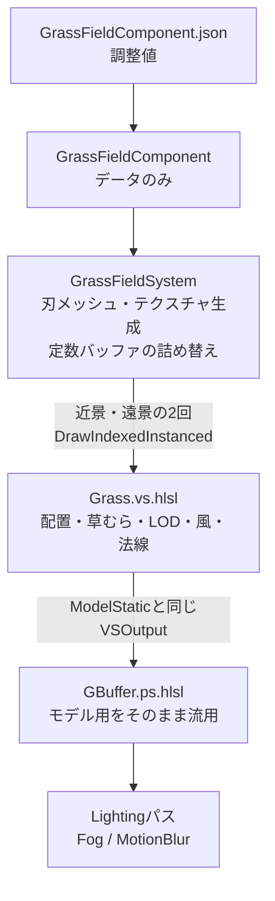

3Dアクションのフィールドを作っていると、地面がただの平面のままだと**どこまで歩いてきたのか**、**どちらへ向かっているのか**が分かりにくくなります。

そこで地面に草を生やすと、足元に密度とうねりが生まれ、風になびく様子だけで世界が動いているように見せることができます。

しかし、草は1本1本が小さいため、画面を埋めるには**何万本**という数が必要になります。

1本ごとに位置や向きをバッファへ持たせると、本数に比例してメモリが膨らみ、カメラの移動に合わせた更新も必要になります。

本記事では、自作エンジン``TsukinoEngine``（``DirectX11`` / ``HLSL``）で制作中のゲーム``CombatAndroid``のコードを用いて、**草1本あたりのメモリを持たずに約13万本の草原を描く**方法を解説したいと思います。

https://github.com/tsukinokun/TsukinoEngine

https://github.com/tsukinokun/combat-android

## 想定環境

- ``Windows11``
- ``DirectX11``
- ``VisualStudio2026``

## 前提知識

- ``C++``の基礎文法を理解している
- ``HLSL``を理解している
- ``インスタンス描画``（``DrawIndexedInstanced``）を理解している
- ``DeferredRendering``を理解している

``DeferredRendering``については[理論編](https://qiita.com/tsukino_/items/571131bb3afe95fa39c1)と[実装編](https://qiita.com/tsukino_/items/181a870bb3bab7075538)で扱っています。

https://qiita.com/tsukino_/items/571131bb3afe95fa39c1

https://qiita.com/tsukino_/items/181a870bb3bab7075538

# 草原描画の考え方

本記事の草描画は、**草1本ぶんのメッシュを1つだけ作り、それをインスタンス描画で大量に並べる**という構成です。

ここまでは一般的なインスタンス描画と同じですが、大きく違うのは**インスタンスバッファを一切持たない**点です。

1本ごとの位置・向き・高さ・揺れの位相は、すべて**その草が生えている場所のワールド座標のハッシュ**から、頂点シェーダーが毎フレーム計算し直します。

```Plain Text
1. CPU：草1本ぶんの刃メッシュを1つだけ作る
   ↓
2. CPU：パラメータを定数バッファへ詰め、インスタンス数を指定して描画
   ↓
3. GPU：SV_InstanceID → ワールドのセル座標 → ハッシュ → 位置・向き・高さ
   ↓
4. GPU：既存のGBuffer用ピクセルシェーダーでそのまま描く
```

そのため、``bladeCount``（草の本数）を増やしてもメモリは1バイトも増えません。

増えるのは頂点シェーダーの実行回数だけです。



### 草原の見た目例


# 刃メッシュ

## 草1本ぶんのメッシュを作る

``TsukinoEngine``を使用したゲーム側では`GrassFieldSystem`がこの処理を担当します。

```cpp:GrassFieldSystem.cpp
Tsukino::GraphicsCommon::MeshData BuildBladeMeshData(float bladeWidth) {
    Tsukino::GraphicsCommon::MeshData mesh;
    mesh.format       = Tsukino::GraphicsCommon::VertexFormat::PositionNormalUV;
    mesh.vertexStride = sizeof(Tsukino::GraphicsCommon::VertexPNUV);

    const Tsukino::u32 verticesPerFace = kBladeSegments * 2 + 1;

    std::vector<Tsukino::GraphicsCommon::VertexPNUV> vertices;
    vertices.reserve(verticesPerFace * kBladeFaceCount);

    //----------------------------------------------------------
    // 面を1枚ぶん積む。根元から先端へ向かって、幅を細らせながら
    // 2頂点ずつ積み、最上段だけは1頂点に潰して尖らせる
    //----------------------------------------------------------
    auto appendFace = [&](bool widthAlongZ) {
        for(Tsukino::u32 row = 0; row <= kBladeSegments; ++row) {
            const float t = static_cast<float>(row) / static_cast<float>(kBladeSegments);

            // 先細りの曲線。1 - t^2 にすると根元側の太さが保たれたまま
            // 先端だけが急に細くなり、草らしいシルエットになる
            const float halfWidth = bladeWidth * 0.5f * (1.0f - t * t);

            if(row == kBladeSegments) {
                // 先端は1点
                Tsukino::GraphicsCommon::VertexPNUV tip{};
                tip.position = {0.0f, t, 0.0f};
                tip.normal   = widthAlongZ ? DirectX::XMFLOAT3{1.0f, 0.0f, 0.0f} : DirectX::XMFLOAT3{0.0f, 0.0f, 1.0f};
                tip.uv       = {0.5f, t};
                vertices.push_back(tip);
                continue;
            }

            Tsukino::GraphicsCommon::VertexPNUV a{};
            Tsukino::GraphicsCommon::VertexPNUV b{};
            if(widthAlongZ) {
                a.position = {0.0f, t, -halfWidth};
                b.position = {0.0f, t, halfWidth};
                a.normal = b.normal = DirectX::XMFLOAT3{1.0f, 0.0f, 0.0f};
            } else {
                a.position = {-halfWidth, t, 0.0f};
                b.position = {halfWidth, t, 0.0f};
                a.normal = b.normal = DirectX::XMFLOAT3{0.0f, 0.0f, 1.0f};
            }
            a.uv = {0.0f, t};
            b.uv = {1.0f, t};
            vertices.push_back(a);
            vertices.push_back(b);
        }
    };

    appendFace(false);    // 面0：幅はX方向
    appendFace(true);     // 面1：幅はZ方向（90度回転）

    // （インデックスの構築は省略）
    return mesh;
}
```

### Height / 高さは1.0で作る

```cpp:GrassFieldSystem.cpp
tip.position = {0.0f, t, 0.0f};
```

刃メッシュの高さは``1.0``で作っておき、実際の高さは頂点シェーダーが掛けます。

こうしておくと、草ごとに高さがばらついても**メッシュは1本で済みます。**

UVの``v``には根元→先端の比率``t``をそのまま入れています。

この値は、頂点シェーダーでは**しなりの重み**、後述のグラデーションテクスチャでは**色の参照位置**として使い回します。

### Taper / 先細り

```cpp:GrassFieldSystem.cpp
const float halfWidth = bladeWidth * 0.5f * (1.0f - t * t);
```

幅は根元から先端へ向かって細らせます。

| t（根元→先端） | 線形 `1 - t` | 二乗 `1 - t²` |
|---|---|---|
| 0.00 | 1.000 | 1.000 |
| 0.25 | 0.750 | 0.938 |
| 0.50 | 0.500 | 0.750 |
| 0.75 | 0.250 | 0.438 |
| 1.00 | 0.000 | 0.000 |

線形だとただの三角形に見えますが、二乗にすると**根元側の太さが保たれたまま先端だけが急に細く**なり、草らしいシルエットになります。

## Cross Billboard / クロスビルボード

最初は板を1枚だけにしていたのですが、**真横に近い角度から見ると厚み0の線に潰れて、奥の地面が素通しに見えました。**

そこで、根元の中心線で直交する板をもう1枚足した``クロスビルボード``にしています。

どの向きから見てもどちらか一方は正面〜斜めに見えるため、地肌が透けにくくなります。


結果として、1本あたり``18頂点``・``42インデックス``（1面あたり``9頂点``・``21インデックス``）になります。

``法線``には、**どちらの面の頂点か**を``one-hot``で入れています。

| 面 | 幅の方向 | normal |
|---|---|---|
| 面0 | X | `(0, 0, 1)` |
| 面1 | Z | `(1, 0, 0)` |

頂点シェーダーはこれを見て幅を出す軸を切り替えます。

**本来の意味での法線としては使っていません。** これが後で効いてきます。

# ワールド座標のハッシュで配置する

ここが本記事で一番重要な部分です。

## インスタンス番号をセルへ分解する

カメラを中心とした正方形のフィールドを格子に切り、各セルに数本ずつ草を置きます。

```hlsl:Grass.vs.hlsl
//----------------------------------------------------------
// インスタンス番号をセル(i, j)とセル内の通し番号へ分解する
//----------------------------------------------------------
const uint perCell   = max((uint)bladesPerCell, 1u);
const uint cellIndex = instanceID / perCell;
const uint slot      = instanceID % perCell;

const uint gridDimU = max((uint)gridDim, 1u);
const uint gridX    = cellIndex % gridDimU;
const uint gridZ    = (cellIndex / gridDimU) % gridDimU;

//----------------------------------------------------------
// セルの原点をカメラ位置でスナップして求める。
// カメラが1セル進むと、格子の端のセルが反対側へ回り込み、
// そこにはその場所ぶんの新しい草が生える
//----------------------------------------------------------
const float2 cameraCell = floor(cameraPos.xz / cellSize);
const float  halfGrid   = floor(gridDim * 0.5f);

const int cellX = (int)(cameraCell.x + (float)gridX - halfGrid);
const int cellZ = (int)(cameraCell.y + (float)gridZ - halfGrid);

const uint seed = MakeCellSeed(cellX, cellZ, slot);
```

### Instance ID / インスタンス番号の分解

```hlsl:Grass.vs.hlsl
const uint cellIndex = instanceID / perCell;
const uint slot      = instanceID % perCell;
```

`SV_InstanceID`を**何番目のセルの、何本目か**に分解します。

``perCell``はセルあたりの本数、``slot``はセルの中での通し番号です。

### Camera Snap / カメラ位置でスナップする

```hlsl:Grass.vs.hlsl
const float2 cameraCell = floor(cameraPos.xz / cellSize);
```

カメラ位置をセル幅で`floor`し、格子の中心を**セル単位でしか動かない**ようにします。

カメラが1セル進むと、格子の端のセルが反対側へ回り込み、そこには**その場所ぶんの新しい草**が生えます。

`cellX`と`cellZ`は**ワールド基準のセル番号**です。

## 乱数の種はワールドのセル番号から作る

1本ごとの個性は、すべてこの``seed``から引きます。

```hlsl:Grass.vs.hlsl
uint HashU32(uint x)
{
    x ^= x >> 16;
    x *= 0x7feb352du;
    x ^= x >> 15;
    x *= 0x846ca68bu;
    x ^= x >> 16;
    return x;
}

float Rand01(uint x)
{
    return float(HashU32(x) & 0x00ffffffu) * (1.0f / 16777216.0f);
}

uint MakeCellSeed(int cellX, int cellZ, uint slot)
{
    // 近景と遠景で同じ並びが繰り返されないよう、層ごとに種をずらす
    const uint layer = (uint)(lodParams.z + 0.5f);

    uint hx = HashU32(asuint(cellX) * 0x9e3779b9u);
    uint hz = HashU32(asuint(cellZ) * 0x85ebca6bu);
    uint hs = HashU32(slot * 0xc2b2ae35u + (uint)swayParams.y + layer * 0x9e3779b9u);

    return HashU32(hx ^ (hz * 0x27d4eb2fu) ^ hs);
}
```

**種にインスタンス番号を使ってはいけません。**

インスタンス番号はカメラから見た相対位置なので、カメラが動くと**同じ番号の草**が別の場所を担当します。

種を`instanceID`から作ると、**カメラの移動に合わせて草が世界を滑っていくように見えます。**

ワールドのセル番号から種を作ることで、**同じ場所には常に同じ草が生える**、つまり草が地面に固定されます。

### asuint / 負の座標

```hlsl:Grass.vs.hlsl
uint hx = HashU32(asuint(cellX) * 0x9e3779b9u);
```

セル番号は原点の反対側で負になります。

`asuint`で``int``のビット列をそのまま``uint``として読み替えることで、負の座標でも破綻せずに混ぜられます。

### Rand01 / 下位24ビット

```hlsl:Grass.vs.hlsl
return float(HashU32(x) & 0x00ffffffu) * (1.0f / 16777216.0f);
```

``float``の仮数部は24ビットなので、下位24ビットだけを使って``2^24``で割ると、分布に偏りが出ません。

32ビット全部を``float``にすると、丸めの影響で``1.0``ちょうどが返る場合があります。

### Jitter / セル内のばらつき

```hlsl:Grass.vs.hlsl
const float2 jitter = float2(Rand01(seed + 1u), Rand01(seed + 2u));
const float2 rootXZ = (float2((float)cellX, (float)cellZ) + jitter) * cellSize;
```

セルの中で一様にばらけさせ、格子が目に見えないようにします。

向き・高さ・揺れの位相も同じように`seed + 3u`、`seed + 4u`…と種をずらして引いています。

## 実際に踏んだバグ：+Z方向だけ草が途切れる

CPU側では、要求された本数から**1辺のセル数**と**1セルあたりの本数**を決めます。

```cpp:GrassFieldSystem.cpp
constexpr float kTargetBladesPerCell = 4.0f;

const float gridDimF   = std::floor(std::sqrt(static_cast<float>(bladeCount) / kTargetBladesPerCell));
const float gridDim    = std::max(gridDimF, 1.0f);
const float cellCountF = gridDim * gridDim;

const Tsukino::u32 cellCount = static_cast<Tsukino::u32>(cellCountF);

// 1セルあたりの本数は切り捨てる
const Tsukino::u32 perCell = std::max(1u, bladeCount / cellCount);

grid.gridDim   = gridDim;
grid.perCell   = perCell;
grid.drawCount = cellCount * perCell;    // 実際に描くのは格子をちょうど埋める本数
```

最初は`perCell`を**切り上げ**、描画する本数には要求された本数をそのまま渡していました。

すると`gridDim² × perCell`が描画本数を上回り、**インスタンス番号が割り当たらないセル**が出ます。

頂点シェーダーは**インスタンス番号 → セル番号**の順に格子を埋めていくので、埋まらなかったセルは格子の後ろの行にまとまります。

その結果、**+Z方向だけ草が近くで途切れる**という、原因の分かりにくい見た目になりました。

`perCell`を切り捨て、描画本数を`cellCount × perCell`にすれば、格子は必ずちょうど埋まります。

実際の設定（``65000本``）では、次のようになります。

```
floor(sqrt(65000 / 4)) = 127
127 × 127 セル × 4本 = 64516本
```

# 草むら

## 碁盤目に見える問題

均一に生やすと、ゴルフ場の芝のような見た目になってしまいます。

そこで草を不定形の**草むら**にまとめ、その間に土が見えるようにしました。

草は3種類（標準の緑 / 丈の低い黄金色 / 丈の高い濃い緑）用意し、草むらごとに種類を変えています。

ここで最初に思いつくのは、**ワールドを正方形の区画に分け、区画ごとに種類を決める**方法です。

しかしこれは**田んぼの碁盤目**に見えます。


## FindClump / 一番近い草むらを探す

``CombatAndroid``では、ワールドを粗い格子に分け、各セルが確率で**草むらを1個持つ**ようにしています。

草むらの中心・半径・形・種類は、すべてそのセルのワールド座標のハッシュから決めます。

```hlsl:Grass.vs.hlsl
for(int dz = -1; dz <= 1; ++dz)
{
    for(int dx = -1; dx <= 1; ++dx)
    {
        const int  cellX = baseX + dx;
        const int  cellZ = baseZ + dz;
        const uint hx    = HashU32(asuint(cellX) * 0x165667b1u);
        const uint hz    = HashU32(asuint(cellZ) * 0xd3a2646cu);
        const uint h     = HashU32(hx ^ (hz * 0xfd7046c5u) ^ seedMix);

        // このセルに塊が無い
        if(Rand01(h) >= spawnChance)
            continue;

        const float2 center = (float2((float)cellX, (float)cellZ) + float2(Rand01(h + 1u), Rand01(h + 2u))) * cellSize;
        const float2 offset = worldXZ - center;
        const float  dist   = length(offset);

        // どう揺らしても届かない塊は、角度の計算をせずに飛ばす
        if(dist >= reachMax)
            continue;

        // 半径は二乗で偏らせ、小さい塊を多めにする
        const float u      = Rand01(h + 3u);
        const float radius = lerp(radiusMin, radiusMax, u * u);

        // 角度方向に波を2つ重ねて、円ではない不定形にする
        const float angle = atan2(offset.y, offset.x);
        const float wobble = 0.6f * sin(2.0f * angle + Rand01(h + 4u) * TWO_PI)
                           + 0.4f * sin(3.0f * angle + Rand01(h + 5u) * TWO_PI);
        const float shapedRadius = max(radius * (1.0f + shapeNoise * wobble), 1.0f);

        const float normDist = dist / shapedRadius;
        if(normDist < result.normDist)
        {
            result.normDist     = normDist;
            result.speciesIndex = HashU32(h + 6u) % kSpeciesCount;
        }
    }
}
```

草1本ごとに、**周囲3×3のセル**から一番近い草むらを探します。

碁盤目を消すために効いているのは次の3つです。

### Center / 中心をばらけさせる

```hlsl:Grass.vs.hlsl
const float2 center = (float2((float)cellX, (float)cellZ) + float2(Rand01(h + 1u), Rand01(h + 2u))) * cellSize;
```

中心をセルの真ん中ではなく、セル内のランダムな位置に置きます。

### Radius / 半径を二乗で偏らせる

```hlsl:Grass.vs.hlsl
const float radius = lerp(radiusMin, radiusMax, u * u);
```

`u`をそのまま使うと大小が均等に出ますが、`u * u`にすると**小さい草むらが多め**になり、ところどころに大きな草むらがある自然な分布になります。

### Wobble / 形を崩す

```hlsl:Grass.vs.hlsl
const float wobble = 0.6f * sin(2.0f * angle + Rand01(h + 4u) * TWO_PI)
                   + 0.4f * sin(3.0f * angle + Rand01(h + 5u) * TWO_PI);
```

角度方向に`sin(2θ)`と`sin(3θ)`の波を重ねて半径を揺らし、**円ではない不定形**にします。

位相を草むらごとにずらしているので、同じ形は出てきません。

## 3×3しか探さないことの制約

**粗いセルの一辺が小さすぎると、セルの境界で草むらが直線的に切れます。**

3×3しか探さないので、2セル先にある草むらはそもそも探索されません。

セルの一辺が**草むらが届く最大距離**より小さいと、本当は届いているはずの草むらが無視されてしまいます。

そのため、セルの一辺はユーザー設定にはせず、CPU側で自動的に合わせています。

```cpp:GrassFieldSystem.cpp
const float clumpShapeNoise = std::clamp(activeField->clumpShapeNoise, 0.0f, 0.5f);
const float clumpCellSize   = clumpRadiusMax * (1.0f + clumpShapeNoise);
```

## 縁のギザギザと、草むらの外の草

```hlsl:Grass.vs.hlsl
const ClumpInfo clump        = FindClump(rootXZ);
const float     edgeSoftness = max(clumpShapeParams.y, 0.01f);
const float     clumpInside  = 1.0f - saturate((clump.normDist - (1.0f - edgeSoftness)) / edgeSoftness);

const bool  inClump  = Rand01(seed + 6u) < inside;
const bool  isFiller = !inClump && (Rand01(seed + 7u) < clumpShapeParams.z);
const float presence = inClump ? lerp(0.6f, 1.0f, inside) : (isFiller ? clumpShapeParams.w : 0.0f);
```

草むらの中かどうかを``0``/``1``で判定すると、縁が綺麗な曲線になってしまいます。

そこで縁の``35%``の幅で**残る確率**を下げていき、1本ごとの乱数で間引きます。

これで縁がギザギザになり、自然に土へ溶け込みます。

草むらの外にも``12%``だけ短い草を残し、土の地面にまばらに生やしています。

**種類は一番近い草むらのものを使います。**

草むらの外の草まで1本ずつバラバラに種類を選ぶと、**砂嵐のようなノイズ**に見えてしまうためです。

### 生えない草を消す

生えない草は、**高さと幅の両方**を``0``にして、18頂点すべてを根元の1点に潰します。

面積が0になるので、1ピクセルも塗られません。

高さだけを``0``にすると、**地面に寝た三角形**が残ってしまいます。

# 色とAO

## グラデーションテクスチャで種類ごとに塗り分ける

ピクセルシェーダーはモデル用の`GBuffer.ps.hlsl`をそのまま使いたいので、草専用の色計算は書けません。

そこで、**種類ごとの根元→先端のグラデーションを縦に並べたテクスチャ**をCPUで作り、``アルベド``として差しています。

```Plain Text
v = 0  ┌────────┐
       │ 種類0  │ rootColor → tipColor（32px）
       ├────────┤
       │ 種類1  │ rootColor → tipColor（32px）
       ├────────┤
       │ 種類2  │ rootColor → tipColor（32px）
v = 1  └────────┘
```

頂点シェーダーは、自分の種類の帯の中へ``v``を押し込むだけです。

```hlsl:Grass.vs.hlsl
const float gradientV = (speciesIndex * kGradientRows + t * (kGradientRows - 1.0f) + 0.5f) / (kGradientRows * (float)kSpeciesCount);

output.uv = float2(input.uv.x, gradientV);
```

`+ 0.5f`は**テクセルの中心**をサンプルするためです。

これが無いと、``t = 0``や``t = 1``のときに**隣の帯の色とブレンド**されてしまいます。

テクスチャはアセットマネージャーに**全種類の色から作ったキー**で登録しているので、同じ色なら2回目以降はキャッシュが返り、色を変えたときだけ作り直されます。

## AOランプ

草は影を落とさない設定にしている（後述）ため、**自己遮蔽の情報が一切ありません。**

そのままだと根元の葉まで空の``アンビエント``を満額受け取り、草むらが平板に光って見えます。

そこでグラデーションと同じ帯構成で、**根元ほど暗い**``AO``テクスチャも作って``AO``スロットに差しています。

```cpp:GrassFieldSystem.cpp
constexpr float kRootAO = 0.35f;    // 根元の遮蔽量（0=真っ暗, 1=遮蔽なし）

// t*t で根元側を広く暗くする。線形だと中腹まで暗くなりすぎる
const float ao = kRootAO + (1.0f - kRootAO) * t * t;
```

**アルベドの根元の色を暗くするのでは代用になりません。**

``AO``は``IBL``（``アンビエント``）にだけ掛かるので、**草の間から空が見えない**ぶんだけを落とせます。

アルベドを下げると日向の直接光まで暗くなり、鮮やかさが失われます。

# 風とかき分け

## 風を3つの成分で作る

風は次の3つの成分の和で、**どれだけ倒れるか**を1つの値にしています。

| 成分 | 内容 |
|---|---|
| 常時なびき | 全体が風下へ傾いた定常状態 |
| 突風 | 風の波が草原を走っていく |
| そよぎ | 草ごとにバラバラな細かい震え |

```hlsl:Grass.vs.hlsl
const float2 windDirXZ = normalize(windParams.xz);

// 突風の波。位相をワールド座標から決めるので、風の波が草原を
// 走っていくように見える（全体が一斉に揺れない）
const float gustPhase = dot(rootXZ, windDirXZ) / max(gustParams.x, 1.0f) - time * (gustParams.y / max(gustParams.x, 1.0f));
const float gust      = sin(gustPhase) * 0.5f + 0.5f;

// 草ごとの細かい震え
const float sway = sin(time * gustParams.w + phase) * swayParams.x;

float  bendAmount = windParams.w + gust * gustParams.z + sway;
float2 bendDir    = windDirXZ;
```

### Gust / 突風

```hlsl:Grass.vs.hlsl
const float gustPhase = dot(rootXZ, windDirXZ) / max(gustParams.x, 1.0f) - time * (gustParams.y / max(gustParams.x, 1.0f));
```

`dot(rootXZ, windDirXZ)`は、**風向きに沿って測った根元の位置**です。

これを位相にすることで、同じ時刻でも場所によって揺れ方がずれ、**明るさの帯が草原を渡っていく**ように見えます。

時間だけを位相にすると、草原全体が一斉に揺れてしまいます。


### Time / 時間はゲーム側から渡す

```hlsl:Grass.vs.hlsl
const float time = fieldParams.w;
```

エンジンは全シェーダーへ経過時間を配っていますが、草ではあえてそれを使っていません。

エンジンの時間は**時間スケールを見ない実時間**なので、**ヒットストップ中に草だけが揺れ続けてしまいます。**

霧や火の粉は止まるので、草だけが動いていると不揃いに見えます。

`GrassFieldSystem`側で`deltaTime`を積算した値を定数バッファに入れることで、ヒットストップ中は草も止まります。

## PlayerPush / プレイヤーのかき分け

```hlsl:Grass.vs.hlsl
if(playerParams.w > 0.0f)
{
    const float2 toBlade = rootXZ - playerParams.xz;
    const float  dist    = length(toBlade);
    const float  push    = saturate(1.0f - dist / playerParams.w);

    if(push > 0.0f)
    {
        // 二乗で落とすと、半径の外側では滑らかにゼロへ収束する
        const float pushAmount = push * push * fadeParams.y;
        const float2 pushDir   = (dist > 0.001f) ? (toBlade / dist) : float2(1.0f, 0.0f);

        bendDir    = normalize(bendDir * bendAmount + pushDir * pushAmount);
        bendAmount = bendAmount + pushAmount;
    }
}

bendAmount = min(bendAmount, 1.4f);    // 倒れすぎて地面へめり込むのを防ぐ
```

プレイヤーに近いほど強く、**プレイヤーから外向き**に倒します。

`push * push`と二乗で落とすことで、半径の外側で滑らかに``0``へ収束します。

倒れる方向は風の向きとかき分けの向きを**強さで重み付けして足して**います。


## Bend / 刃を曲げる

```hlsl:Grass.vs.hlsl
const float bendCurve = bendAmount * t * t;

worldPos.xz = rootXZ + sideDir * (input.position.x * widthScale) + facingDir * (input.position.z * widthScale)
            + bendDir * (bendCurve * height);

// 曲がったぶんだけ背が縮む（弧長を保つ近似）
worldPos.y = bladeParams.z + t * height * (1.0f - bendCurve * bendCurve * 0.35f);
```

曲がり具合に`t * t`を掛けているので、**根元は動かず、先端ほど大きく曲がります。**

根元が動かないため、草が地面から浮くことはありません。

横に倒れたぶんだけ背を縮めているのは、**刃の長さ（弧長）がだいたい保たれる**ようにするためです。

これが無いと、強い風で草が伸びて見えます。

クロスビルボードの2面は、`input.position.x`（面0）と`input.position.z`（面1）の**どちらか片方が必ず0**なので、両方を足しても実質的に片方だけが効きます。

# 法線

## 実際に踏んだバグ：1本の草が白と黒に割れる

見た目に一番効いたのがこの修正です。

最初はクロスビルボードの**面の向きをそのまま法線に**していました。

しかし2枚の板は、**水平かつ互いに90度違う法線**を持ちます。

太陽の光は水平成分が大きいので、片面は``NdotL ≒ 0.9``、もう片面は``0``に割れます。

2枚は根元で交差して画面上の同じ場所を占めるため、**1本の草が白い面と濃い緑の面に分かれて見えました。**


## 株全体を地面の一部とみなす

``CombatAndroid``では、法線を**ほぼ真上**にして、水平成分を少しだけ残しています。

```hlsl:Grass.vs.hlsl
static const float kHorizontalWeight = 0.12f;    // 上向き1.0に対して水平成分をどれだけ残すか
static const float kRoundOut         = 0.35f;    // 幅方向の丸め（水平成分の向きを方位角で振る量）
static const float kBendTilt         = 0.25f;    // 曲がりに応じて風上へ倒す量

const float2 faceNormalXZ = input.normal.x * sideDir + input.normal.z * facingDir;
const float2 widthAxisXZ  = input.normal.z * sideDir + input.normal.x * facingDir;

float2 shadeXZ = faceNormalXZ
               + widthAxisXZ * ((input.uv.x * 2.0f - 1.0f) * kRoundOut)
               - bendDir * (bendCurve * kBendTilt);

// 重みを掛ける前に長さを1へ揃える
const float shadeLen = length(shadeXZ);
shadeXZ = (shadeLen > 1.0e-4f) ? (shadeXZ / shadeLen) : float2(0.0f, 0.0f);

output.normal = normalize(float3(shadeXZ.x * kHorizontalWeight, 1.0f, shadeXZ.y * kHorizontalWeight));
```

### Horizontal / 水平成分に混ぜるもの

水平成分をすべて捨てると、草原が平板に見えます。

そこで次の3つを混ぜています。

| 成分 | 役割 |
|---|---|
| 面の向き | 葉ごとの個性 |
| 幅方向の丸め | 1本の中の左右の陰影 |
| 風の曲がり | 風上へ倒す。風の波が明るさの帯として草原を渡る |

`input.normal`は``one-hot``で**どちらの面か**を表しているので、`input.normal.x * sideDir + input.normal.z * facingDir`とすると、その面の水平方向の向きが取り出せます。

### Normalize / 重みを掛ける前に正規化する

```hlsl:Grass.vs.hlsl
shadeXZ = (shadeLen > 1.0e-4f) ? (shadeXZ / shadeLen) : float2(0.0f, 0.0f);
```

**ここを省くと、明るさがちらつきます。**

3成分の合計の長さは、葉ごと・フレームごと（風で`bendCurve`が変わる）に変わります。

長さがばらついたまま`kHorizontalWeight`を掛けると、法線の仰角がばらつき、明るさが揺れて見えます。

### kHorizontalWeight / 水平成分を増やしすぎない

```hlsl:Grass.vs.hlsl
static const float kHorizontalWeight = 0.12f;
```

**水平成分を増やしすぎると、白黒の割れが戻ってきます。**

太陽の仰角が``26.57度``の場合、法線が水平から``63.43度``より寝ると、風下側の面の``NdotL``が`saturate`で``0``に張り付きます。

実際に値を変えて確認したところ、``0.22``でもまだ割れが見えたため、``0.12``まで寝かせています。

# 近景と遠景

## 2層に分ける理由

1回の描画で地平線まで敷くと、画面上で数ピクセルにしかならない遠くの草にまで、近景と同じ密度を割くことになります。

そうなると、本数が何倍にも膨らみます。

そこで、**密で細い近景**と**疎で太い遠景**の2回に分けて描いています。

| 層 | 範囲（一辺） | 本数 | セルの一辺 |
|---|---|---|---|
| 近景 | 60m | 64516本 | 約47cm |
| 遠景 | 90m | 64516本 | 約71cm |

2層は同じメッシュ・同じシェーダーで、**定数バッファの値だけ**が違います。

## LOD / 切り替えは本数で行う

```hlsl:Grass.vs.hlsl
const float lodT    = saturate((distFromCam - lodParams.x) / max(lodParams.y - lodParams.x, 1.0f));
const float lodKeep = (lodParams.z > 0.5f) ? lodT : (1.0f - lodT);

if(Rand01(seed + 8u) >= lodKeep)
{
    return MakeCulledVertex();
}
```

切り替えの距離帯（``22m``〜``28m``）では、近景は奥ほど、遠景は手前ほど**1本ごとの乱数で間引き**ます。

最初は**背を縮めて**入れ替えていたのですが、距離帯の中で草原が一段低く沈んで見えました。

背は保ったまま**本数だけ**を入れ替えると、境目がほとんど分からなくなります。

### MakeCulledVertex / 描かない草

```hlsl:Grass.vs.hlsl
VSOutput MakeCulledVertex()
{
    VSOutput output = (VSOutput)0;
    output.position = float4(0.0f, 0.0f, -1.0f, 1.0f);
    output.curClip  = output.position;
    output.prevClip = output.position;
    return output;
}
```

間引かれた草は、全頂点を**クリップ範囲外の1点**にします。

面積が0になるので、1ピクセルも塗られません。

**この判定を草むらの探索（3×3のハッシュ）より前に置くことが重要です。**

間引かれる草に対して重い探索を回さずに済みます。

## 遠景の隙間を埋める

本数の少ない遠景をそのまま描くと、スカスカに見えます。

``CombatAndroid``では3つの工夫を重ねています。

### Density / 密度比で幅を太らせる

```cpp:GrassFieldSystem.cpp
// 面積あたりの本数の比だけ遠景の草を太らせ、画面を覆う割合を近景と揃える。
// 太らせすぎると1本1本が板に見えるので4倍で頭打ちにする
const float nearDensity          = static_cast<float>(nearGrid.drawCount) / (nearFieldSize * nearFieldSize);
const float farDensity           = static_cast<float>(farGrid.drawCount) / (farFieldSize * farFieldSize);
const float farWidthCompensation = std::clamp(nearDensity / farDensity, 1.0f, 4.0f);
```

面積あたりの本数の比だけ遠景の草を太らせ、**画面を覆う割合**を近景と揃えます。

今回の設定では``(90 / 60)² = 2.25倍``になります。

太らせすぎると1本1本が板に見えるので、``4倍``で頭打ちにしています。

### Distance / 距離の二乗で幅を太らせる

```hlsl:Grass.vs.hlsl
const float distNorm   = saturate(distFromCam / max(coverageParams.z, 1.0f));
const float widthScale = speciesWidth * (1.0f + distNorm * distNorm * bladeParams.x) * coverageParams.w * alive;
```

遠くの草ほど幅を広げます。

二乗で効かせているので、**手前の草の細さはそのまま**保たれます。

### HorizonFill / 遠くほど草むらの隙間を埋める

```hlsl:Grass.vs.hlsl
const float horizonFill = smoothstep(coverageParams.x, coverageParams.y, distFromCam);
const float inside      = lerp(clumpInside, 1.0f, horizonFill);
```

遠くでは草むらの形はもう見分けられず、**隙間の土だけが霧に溶けた帯**として目立ちます。

そこで、遠くほど草むらの隙間を草で埋めていきます。

種類は草むらのものを使い続けるので、**色のむらは遠くでも残ります。**


## 実際に踏んだバグ：近景と遠景が同じ値で描かれる

```cpp:GrassFieldSystem.cpp
for(Tsukino::u32 layerIndex = 0; layerIndex < layerCount; ++layerIndex) {
    const GrassLayer&                      layer  = layers[layerIndex];
    Tsukino::Renderer::UserConstantBuffer& buffer = m_paramBuffers[layerIndex];

    // （初回だけバッファを作成）

    params.fieldParams    = hlslpp::float4(layer.fieldSize, layer.grid.gridDim, static_cast<float>(layer.grid.perCell), m_time);
    params.lodParams      = hlslpp::float4(layer.lodStart, layer.lodEnd, layer.layerIndex, layer.fadeStart);
    params.coverageParams = hlslpp::float4(horizonFillStart, horizonFillEnd, nearHalf, layer.widthCompensation);

    Tsukino::Renderer::UpdateUserConstantBuffer(ctx->renderer->GetContext(), buffer, &params, sizeof(params));

    Tsukino::Renderer::DrawCommand cmd{};
    cmd.mesh          = &m_bladeMesh;
    cmd.material      = &material;
    cmd.materialData  = &materialData;
    cmd.transform     = Tsukino::Core::Math::matrix::identity();
    cmd.prevTransform = cmd.transform;
    cmd.hasPrevFrame  = false;
    cmd.pass          = Tsukino::Renderer::RenderPass::GBuffer;
    cmd.instanceCount = layer.grid.drawCount;
    cmd.castsShadow   = false;

    // 草のパラメータをゲーム予約枠(b12)へ渡す
    cmd.userConstantBuffer = buffer.buffer.Get();
    cmd.userConstantSlot   = Tsukino::Renderer::CBSlot::User0;

    ctx->renderer->GetDrawQueue().Push(cmd);
}
```

``TsukinoEngine``の描画コマンドは、定数バッファを**指しているだけ**で、実際の描画は後でまとめて行われます。

そのため、1本の定数バッファを書き換えながら2回コマンドを積むと、**両方とも最後に書いた値で描かれます。**

``CombatAndroid``では、定数バッファを**層の数だけ**持つことで解決しています。

位置も向きも頂点シェーダーがワールド座標で直接組み立てるので、モデル行列は単位行列です。

# GBufferパスに相乗りする

## VSOutputを揃える

```hlsl:Grass.vs.hlsl
struct VSOutput
{
    float4 position : SV_POSITION;
    float3 worldPos : POSITION;
    float3 normal   : NORMAL;
    float2 uv       : TEXCOORD0;
    float4 curClip  : TEXCOORD1;
    float4 prevClip : TEXCOORD2;
};
```

草の頂点シェーダーの出力を、モデル用の頂点シェーダー（`ModelStatic.vs.hlsl`）の出力と**完全に同じ構造体**にしています。

これだけで、ピクセルシェーダーはモデル用の`GBuffer.ps.hlsl`をそのまま使えます。

マテリアルは``metallic 0``、``roughness 0.85``の普通の``PBR``マテリアルとして設定しているだけで、``ディファードライティング``・``ポイントライト``・``フォグ``が自動で乗ります。

## PrevClip / モーションブラー

```hlsl:Grass.vs.hlsl
output.prevClip = mul(float4(worldPos, 1.0f), prevViewProj);
```

草は前フレームの姿勢を持っていないので、風の揺れを速度に載せることはできません。

ただし、**現在の`worldPos`を前フレームの`viewProj`に通せば、カメラ移動ぶんの速度は正しく出ます。**

最初はここを`clipPos`（今フレームと同じ値）にしていたため、草の速度が常に``0``になっていました。

その結果、**カメラを振ったときに地面だけが流れて、草が固まって見えていました。**

## 草は影を落とせない

```cpp:GrassFieldSystem.cpp
cmd.castsShadow = false;
```

草は影を落とさない設定にしています。

``TsukinoEngine``のシャドウパスは、固定のシャドウ用頂点シェーダーで描き直します。

草のように**頂点シェーダーが位置を組み立てるもの**をそのまま通すと、**全インスタンスが原点に重なった状態で**シャドウマップに書かれてしまいます。

シャドウマップについては以下の記事で扱っています。

https://qiita.com/tsukino_/items/d1839a99b6eaf4310a21

影を落とさせるには、シャドウパスでも専用の頂点シェーダーを差し替えられるようにする必要があり、今後の課題です。

その代わりとして、前述の``AOランプ``で根元を暗くしています。

# パラメータ一覧

調整値はすべて``JSON``（プレハブ）に出しているので、再ビルドなしで調整できます。

主要なものを抜粋します（単位は``cm``）。

| パラメータ | 値 | 意味 |
|---|---|---|
| `bladeCount` / `fieldSize` | 65000 / 6000 | 近景の本数と一辺 |
| `farBladeCount` / `farFieldSize` | 65000 / 9000 | 遠景の本数と一辺 |
| `lodBlendStart` / `lodBlendEnd` | 2200 / 2800 | 近景→遠景の切り替え距離帯 |
| `horizonFillStart` / `horizonFillEnd` | 1500 / 2800 | 草むらの隙間を埋める距離帯 |
| `bladeWidth` | 5.5 | 根元の幅 |
| `species[].height` | 34 / 22 / 46 | 種類ごとの高さ |
| `clumpRadiusMin` / `clumpRadiusMax` | 60 / 250 | 草むらの半径 |
| `clumpSpawnChance` | 0.8 | 粗いセルが草むらを持つ確率 |
| `fillerDensity` | 0.12 | 草むらの外に残す草の割合 |
| `windStrength` / `gustStrength` | 0.4 / 0.55 | 常時なびき / 突風の強さ |
| `gustWavelength` / `gustSpeed` | 650 / 320 | 突風の波長 / 速さ |
| `playerPushRadius` | 90 | かき分けの半径 |

霧（``Fog``）も風向きを持っていて、ノイズがその向きへ流れています。

**草だけ別方向になびくと世界が壊れて見えるので、草と霧の風向きは必ず同じ値にします。**

# 総括

- 草の位置・向き・高さ・揺れを**ワールドのセル座標のハッシュ**から作れば、草1本あたりのメモリは0で、カメラが動いても草は地面に固定される

- 乱数の種に`SV_InstanceID`を使うと草が世界を滑る。必ず**ワールド基準のセル番号**から作る

- 草むらは**粗い格子＋3×3探索＋不定形の半径**で碁盤目を消せる。セルの一辺は草むらが届く最大距離に合わせる

- ピクセルシェーダーを書き換えずに色分けするには、**種類ごとの帯を並べたグラデーションテクスチャ**を使い、頂点シェーダーで``v``をずらす

- クロスビルボードの法線は**ほぼ上向き**にしないと白黒に割れる。水平成分は**正規化してから**重みを掛ける

- 近景と遠景の切り替えは、背ではなく**本数**で入れ替える。遠景は密度比と距離で幅を補う

- `VSOutput`を既存のモデルと揃えれば、ピクセルシェーダーとライティングは丸ごと流用できる
